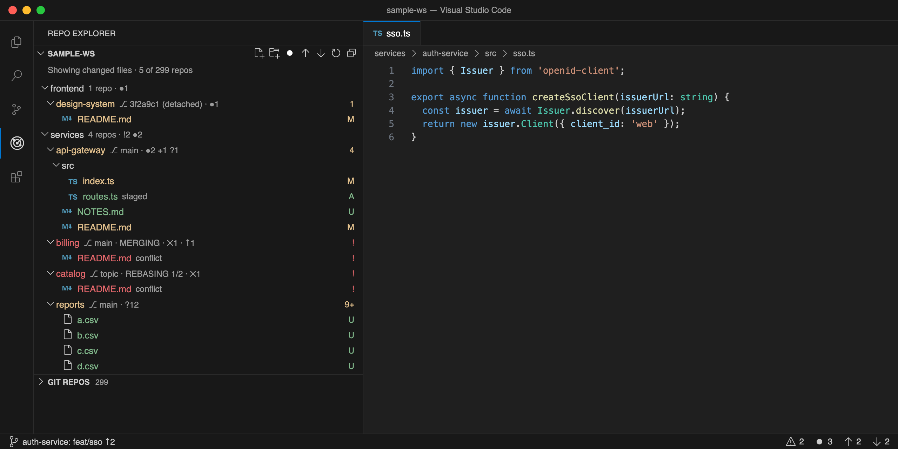
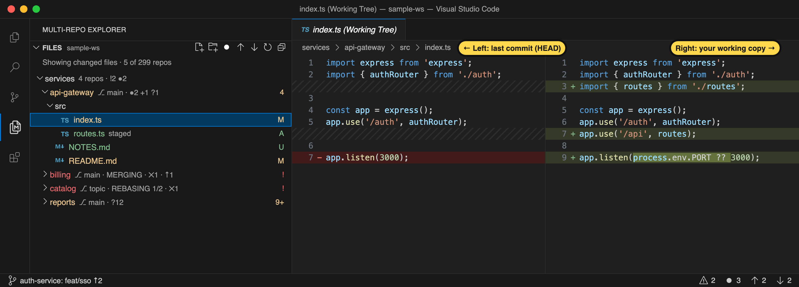
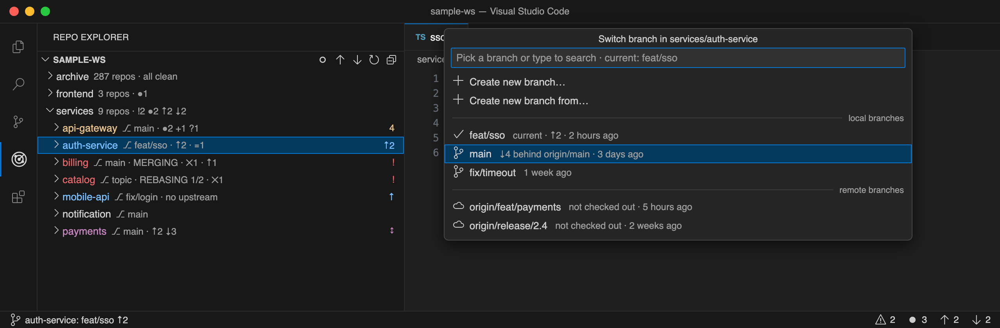
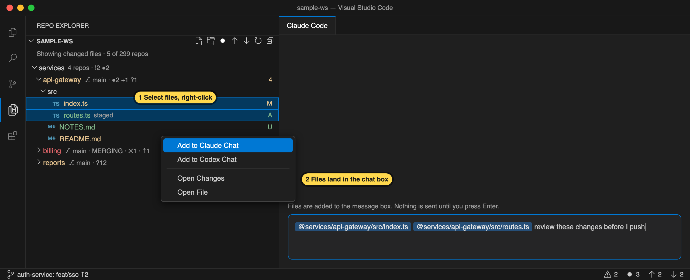
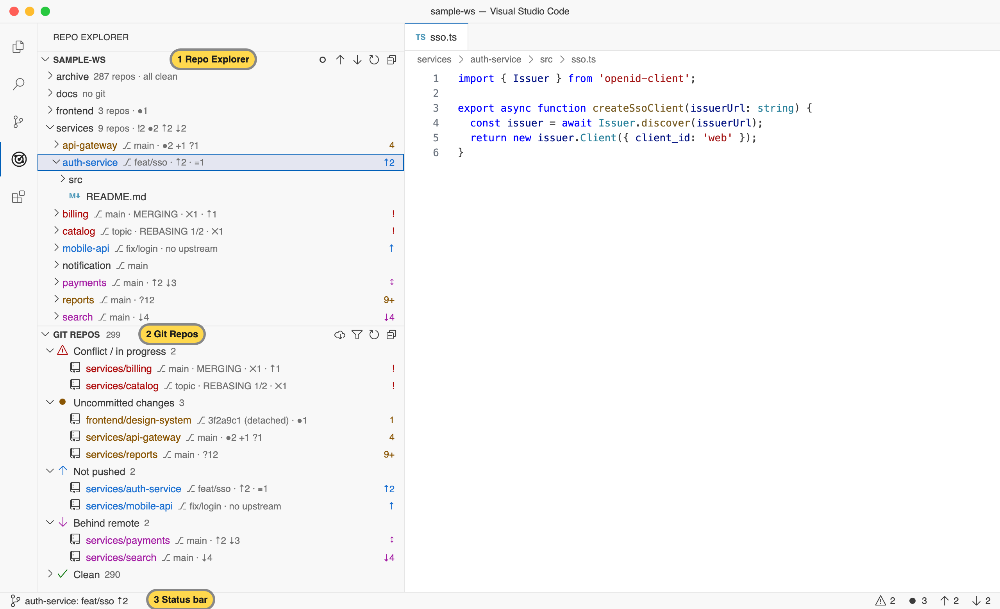
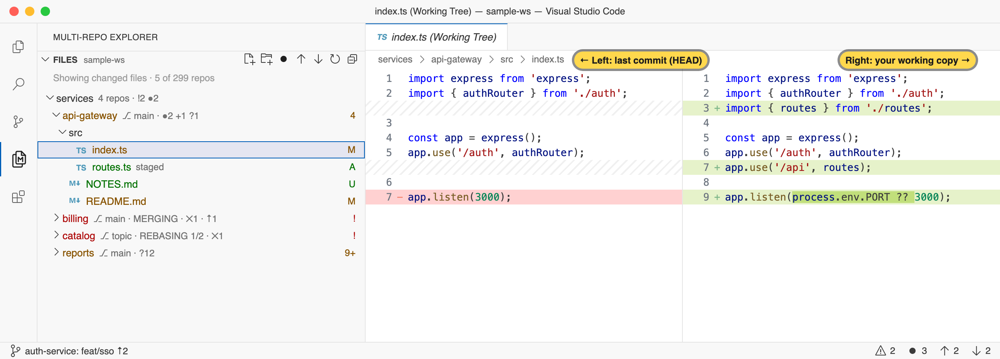

# Multi-Git Explorer

[](https://github.com/prateep-r/vscode-multi-git-explorer/releases/latest)
[](https://code.visualstudio.com/)
[](LICENSE)

**See the branch and git status of every repository in your workspace at a glance, even with hundreds of repos.**

When you keep many repositories in one folder (microservices, a polyrepo, or a `~/projects` folder), it is hard to keep track of which repo is on which branch, which ones have uncommitted work, and which ones you forgot to push. Multi-Git Explorer shows all of this next to the folder names. You can narrow the tree down to what changed, review diffs, switch branches, and send files to an AI chat, all from a right-click.


1. **Files**: your workspace, with each repo's branch and status after its name.
2. **Git Repositories**: every repo, grouped by what needs attention, with problems first.
3. **Status bar**: the branch of the repo you are editing in (left) and totals for all repos (right).

## Highlights

- **Every repo's state on one screen.** It shows the branch, uncommitted changes, unpushed and behind commits, conflicts, and merges or rebases in progress.
- **Filters for what changed.** Show only repos with changed files, unpushed commits, or new commits on the remote.
- **One-click review.** Open a diff of any changed file against `HEAD`, or every change in a repo in one view.
- **Branch switching.** Switch to a local or remote branch, or create one, with your uncommitted changes stashed only if you agree.
- **Familiar file tree.** It has the built-in Explorer's right-click menu, keyboard shortcuts, and drag and drop.
- **Built for scale.** 300 repos are found in about 50 ms and fully checked in about 4 seconds. Showing status never fetches, pushes, or changes your repos.

## Contents

- [Getting started](#getting-started)
- [Features](#features)
  - [See every repo's branch and status](#see-every-repos-branch-and-status)
  - [Show only what changed](#show-only-what-changed)
  - [Review a change](#review-a-change)
  - [Switch branches](#switch-branches)
  - [Right-click menus](#right-click-menus)
  - [Keyboard shortcuts](#keyboard-shortcuts)
  - [Send files to an AI chat](#send-files-to-an-ai-chat)
  - [Badges in the built-in Explorer](#badges-in-the-built-in-explorer)
  - [Light and dark themes](#light-and-dark-themes)
- [Status reference](#status-reference)
- [Installation](#installation)
- [Settings](#settings)
- [What the extension changes](#what-the-extension-changes)
- [Performance](#performance)
- [Troubleshooting](#troubleshooting)
- [Known limitations](#known-limitations)
- [Feedback](#feedback)
- [License](#license)

## Getting started

**Requirements:** VS Code 1.95 or later, and `git` on your `PATH` (or set in `git.path`).

1. Install **Multi-Git Explorer** from the Extensions view, or see [Installation](#installation).
2. Open the folder that holds your repos (**File → Open Folder…**).
3. Click the **Multi-Git Explorer** icon (two pages with an M) in the Activity Bar. It opens by itself the next time you open the window.

Repos are found automatically, up to 10 folder levels deep. Each repo shows its branch right away, and the rest of its status fills in within a few seconds.

## Features

### See every repo's branch and status

- **Files** works like the built-in Explorer. Expand folders, click files to open them, and use **New File** and **New Folder** in its title bar or on a folder's right-click menu. Typing a path such as `src/utils/date.ts` creates the folders on the way.
- **Each repo** shows its branch and status after its name. Folders that contain repos show a summary such as `9 repos · !2 ●2 ↑2 ↓2`, so you can tell what's inside without expanding them. Changed files carry the same letters as Source Control (`M`, `A`, `U`, and so on).
- **Git Repositories** lists every repo in groups: *Conflict / in progress*, *Uncommitted changes*, *Not pushed*, *Behind remote*, and *Clean*. Use the filter icon in its title bar to find a repo by path or branch name. Hover a row for buttons that open it in Source Control or in a terminal.
- **The status bar** shows the branch of the file you're editing on the left; click it to open that repo in Source Control. The item on the right counts repos by state; click it to jump to Git Repositories.
- **Tooltips** on a repo show the full picture: upstream, ahead and behind counts, changed files, stashes, and when it was last fetched.

### Show only what changed

The title bar of the file tree has three filter buttons. Click a button to turn its filter on, and click it again to turn it off. The icon is filled while the filter is on. You can combine filters; a repo is shown if it matches any of them.

| Filter | Icon when off | Icon when on | Shows |
| --- | --- | --- | --- |
| Changed files | ○ | ● | Repos with uncommitted or conflicted files, listing only those files and their folders |
| Not pushed | ↑ | ⬆︎ in a circle | Repos with commits that aren't pushed yet |
| Behind remote | ↓ | ⬇︎ in a circle | Repos with new commits on the remote, as of the last fetch |



Changed files use the same letters as Source Control: `M` modified, `A` added, `D` deleted, `R` renamed, `U` untracked, and `!` conflict. A note such as `staged`, `partly staged`, or `conflict` may follow the letter.

Folders listed in `multiGitExplorer.exclude` and anything hidden by `files.exclude` stay hidden while filtering, even if git sees changes in them. The filter is remembered per workspace.

To search by file name or content, right-click a folder or repo and choose **Find in Folder…**. It opens the Search view limited to that folder.

### Review a change

With **Changed files** on, click a file to review it. A diff opens comparing the last commit (`HEAD`) with your working copy, so staged and unstaged changes appear together.



- Added lines are green and removed lines are red. Within a changed line, the exact part that changed is highlighted.
- New files appear fully added and deleted files fully removed. Renamed files are compared with their old name.
- Files with conflicts open as normal files, so you can resolve them.
- The diff opens as a preview tab, so the next file you click replaces it instead of opening another tab.
- To edit the file, use the **Open File** button on its row.
- To review every changed file in a repo in one tab, right-click the repo and choose **View All Changes**.

### Switch branches

Right-click a repo and choose **Switch Branch…**, the first item in the menu.



- **Local branches** are listed newest first. Each shows how far it is ahead of or behind its upstream, and whether the upstream was deleted.
- **Remote branches** you haven't checked out yet follow. Picking one creates a local branch that tracks it.
- **Create new branch…** starts a branch from where you are. **Create new branch from…** lets you choose the starting branch. Names are checked against git's rules as you type.
- **Uncommitted changes** move to the new branch when git allows it. If they would be overwritten, you're asked whether to **Stash and Switch**. Your changes are then kept in a stash, which you can restore with `git stash pop`.
- Switching is not allowed while a merge or rebase is in progress, so finish or abort it first.

### Right-click menus


The **Files** menu has the built-in Explorer's commands, plus git commands on repos. To act on several rows at once, select them first with <kbd>Cmd</kbd>/<kbd>Ctrl</kbd>+click or <kbd>Shift</kbd>+click.

**Repo commands** appear at the top of a repo's menu:

| Command | What it does |
| --- | --- |
| Switch Branch… | Switches to a branch, or creates one ([details](#switch-branches)) |
| Open in Source Control | Opens the repo in VS Code's Git and shows the Source Control view |
| View All Changes | Opens every changed file in the repo in one diff view |
| Fetch / Pull / Push | Runs the git command for this repo. Push sets an upstream if the branch has none |
| Open Repo in New Window | Opens only this repo in a new VS Code window |
| Copy Branch Name | Copies the current branch name |

Fetch appears only for repos with a remote, Pull only for branches with an upstream, and Push only when there is something to push.

**File and folder commands** work like the built-in Explorer:

| Command | Shows on | What it does |
| --- | --- | --- |
| Open Changes / Open File | Changed files | Opens the diff against `HEAD`, or the file itself |
| Open to the Side | Files | Opens the file in an editor beside the current one |
| Add to Claude Chat / Add to Codex Chat | Files | Adds the files to that chat ([details](#send-files-to-an-ai-chat)) |
| Copy to AI Chat | All rows | Copies `@path` mentions to paste into any AI chat |
| New File… / New Folder… | Folders, repos | Creates an item. A path such as `src/utils/date.ts` creates the folders on the way |
| Reveal in Finder | All rows | Shows the item in Finder. Called *Reveal in File Explorer* on Windows and *Open Containing Folder* on Linux |
| Open in Integrated Terminal | All rows | Opens a terminal in the folder, or in the folder that contains the file |
| Reveal in Explorer View | All rows | Selects the same item in the built-in Explorer, where other extensions' menu items appear |
| Find in Folder… | Folders, repos | Opens the Search view limited to the folder |
| Select for Compare, then Compare with Selected | Files | Shows the differences between two files. With two files selected, use **Compare Selected** |
| Open Timeline | Files | Opens the file and shows its history (commits and local saves) in the Timeline view |
| Cut / Copy / Paste | All rows | Moves or copies items to another folder. Pasting onto a taken name creates `name copy.ext`; moving onto a taken name asks before replacing it |
| Copy Path / Copy Relative Path | All rows | Copies the full path, or the path from the project folder. Several rows are copied one per line |
| Copy Remote File URL / Open on Remote (Web) | Rows in a repo with a remote | Copies or opens the item's page on its git host ([details](#links-to-the-remote-website)) |
| Rename… | All rows except workspace folders | Renames the item. Open editors follow it, and languages such as TypeScript update imports |
| Delete | All rows except workspace folders | Moves the items to the Trash after asking ([details](#what-the-extension-changes)) |

While **Changed files** is on, rows for deleted files offer only the commands that don't need the file: Open Changes, Copy Path, Copy Relative Path, the remote links, and Copy to AI Chat.

**More ways to work with the tree:**

- **Drag and drop** items onto a folder to move them. You're asked first unless `explorer.confirmDragAndDrop` is off. Editors and imports follow the move, just as in the built-in Explorer.
- **Scan This Folder** appears on folders deeper than the scan limit. Expanding the folder does the same.
- **Git Repositories** has **Fetch All Repos**, **Filter Repos**, and **Refresh** in its title bar. Its rows have the repo commands above, plus **Open Terminal Here** and **Copy to AI Chat**.
- **The Command Palette** lists every command under *Multi-Git Explorer*.

> Other extensions add their own items (such as *New Java File* or *Run Tests*) only to the built-in Explorer's menu, and VS Code doesn't allow them here. Use **Reveal in Explorer View** to reach them.

#### Links to the remote website

**Copy Remote File URL** and **Open on Remote (Web)** link to the branch's upstream, so the page shows what you last pushed. A branch that was never pushed links to the remote's default branch instead, and a detached HEAD links to its commit.

The type of git host is detected from the host name: `github`, `bitbucket.org`, `dev.azure.com`, Bitbucket Server's `/scm/` paths, and Gitea or Codeberg. Other self-hosted servers are treated as GitLab. If yours is different, such as GitHub Enterprise on its own domain, set it in `multiGitExplorer.remoteHosts`:

```jsonc
"multiGitExplorer.remoteHosts": {
  "git.mycompany.com": "github"   // github, gitlab, bitbucket, bitbucket-server, azure or gitea
}
```

### Keyboard shortcuts

These shortcuts work when the **Files** tree has focus, so click a row first. As in the built-in Explorer, clicking a file opens a preview and keeps focus in the tree, so the shortcuts act on the row rather than the editor.

| Command | macOS | Windows / Linux |
| --- | --- | --- |
| Open to the Side | <kbd>Cmd</kbd>+<kbd>Enter</kbd> | <kbd>Ctrl</kbd>+<kbd>Enter</kbd> |
| Rename… | <kbd>F2</kbd> | <kbd>F2</kbd> |
| Delete | <kbd>Cmd</kbd>+<kbd>Backspace</kbd> | <kbd>Delete</kbd> |
| Cut / Copy / Paste | <kbd>Cmd</kbd>+<kbd>X</kbd> / <kbd>C</kbd> / <kbd>V</kbd> | <kbd>Ctrl</kbd>+<kbd>X</kbd> / <kbd>C</kbd> / <kbd>V</kbd> |
| Copy Path | <kbd>Alt</kbd>+<kbd>Cmd</kbd>+<kbd>C</kbd> | <kbd>Shift</kbd>+<kbd>Alt</kbd>+<kbd>C</kbd> |
| Copy Relative Path | <kbd>Alt</kbd>+<kbd>Shift</kbd>+<kbd>Cmd</kbd>+<kbd>C</kbd> | <kbd>Ctrl</kbd>+<kbd>Shift</kbd>+<kbd>Alt</kbd>+<kbd>C</kbd> |
| Reveal in Finder / File Explorer / containing folder | <kbd>Alt</kbd>+<kbd>Cmd</kbd>+<kbd>R</kbd> | <kbd>Shift</kbd>+<kbd>Alt</kbd>+<kbd>R</kbd> (Windows), <kbd>Ctrl</kbd>+<kbd>Alt</kbd>+<kbd>R</kbd> (Linux) |
| Find in Folder… | <kbd>Shift</kbd>+<kbd>Alt</kbd>+<kbd>F</kbd> | <kbd>Shift</kbd>+<kbd>Alt</kbd>+<kbd>F</kbd> |

With several rows selected, a shortcut acts on all of them, except Rename, which renames one. Shortcuts don't fire while you type in the tree's find box. To change them, open **Preferences → Keyboard Shortcuts** and search for *Multi-Git Explorer*.

### Send files to an AI chat

Right-click in **Files** to send files to an AI chat, or select several rows first to send them all at once. Combined with the **Changed files** filter, this is a quick way to ask for a review of what you're about to push.



| Right-click on | Command | Result |
| --- | --- | --- |
| A file | **Add to Claude Chat** / **Add to Codex Chat** | Adds the file to the chat's message box. Appears when [Claude Code](https://marketplace.visualstudio.com/items?itemName=anthropic.claude-code) or [Codex](https://marketplace.visualstudio.com/items?itemName=openai.chatgpt) is installed |
| Any row | **Copy to AI Chat** | Copies `@path` mentions, such as `@src/utils/ @README.md`, to paste with <kbd>Cmd</kbd>/<kbd>Ctrl</kbd>+<kbd>V</kbd>. If Claude Code or Codex is the only chat installed, it opens for you |

- Nothing is sent until you press <kbd>Enter</kbd> in the chat.
- `@path` mentions work in Claude Code, Codex, Cursor, Windsurf, and Gemini. GitHub Copilot Chat uses `#file:` instead, so it doesn't read them.
- Folders are copied rather than added, because neither chat extension offers a way to add a folder.
- Claude Code can only mention the file open in the editor, so **Add to Claude Chat** briefly opens each file in a preview tab first. If a chat extension refuses a file, its `@path` is copied instead.

Tested with Claude Code 2.1.318 and Codex 26.1021. Each chat extension decides how to show what it receives, so this may change as they update.

### Badges in the built-in Explorer

The built-in Explorer is left unchanged by default. Turn on `multiGitExplorer.decorateExplorer` to give repo folders there a color, a short badge, a tooltip, and a **Git Repo** right-click menu with the repo commands.


> VS Code lets extensions show only a color and a badge of up to two characters in the built-in Explorer. To see branch names next to folders, use the **Multi-Git Explorer** view.

### Light and dark themes

Colors follow your theme. Changed files use the theme's git colors, the same as the built-in Explorer and Source Control. Repo states use colors with separate values for light, dark, and high-contrast themes. The screenshots above use *Dark Modern*; here is the same workspace with *Light Modern*:





To customize the colors, see [Colors](#colors).

## Status reference

**Badges** show a repo's most important state:

| Badge | Color | Meaning |
| --- | --- | --- |
| *(none)* | Default | Clean and in sync with its upstream |
| `4`, `9+` | Yellow | Files with uncommitted changes |
| `↑2` | Blue | 2 commits not pushed yet |
| `↑` | Blue | The branch has never been pushed (no upstream) |
| `↓4` | Purple | 4 commits behind the remote, as of the last fetch |
| `↕` | Purple | Diverged: commits to push *and* to pull |
| `!` | Red | Files with merge conflicts |
| `M` `R` `C` `V` | Red | Merge, rebase, cherry-pick, or revert in progress |
| `D` | Yellow | Detached HEAD (not on a branch) |
| `…` | Gray | Still checking |
| `⚠` | Red | The status could not be read. Hover for the error |

**The text after a repo's name** shows all of its states:

| Text | Meaning |
| --- | --- |
| `⎇ main` | Current branch |
| `●2` | 2 files modified |
| `+1` | 1 file staged |
| `?1` | 1 untracked file |
| `✕1` | 1 file with conflicts |
| `↑2 ↓3` | 2 commits to push, 3 to pull |
| `≡1` | 1 stash entry |
| `MERGING`, `REBASING 1/2` | An operation is in progress (here, rebase step 1 of 2) |
| `no upstream` | The branch has never been pushed |
| `submodule` | The repo is a submodule of the repo that contains it |

**Folders that aren't repos** show one of:

| Text | Meaning |
| --- | --- |
| `no git` | No repos inside |
| `not scanned` | Deeper than the scan limit. Expand it, or right-click and choose **Scan This Folder** |
| `excluded` | Listed in `multiGitExplorer.exclude` |

Repos without a remote are never flagged as unpushed.

## Installation

### VS Code Marketplace

Search for **Multi-Git Explorer** in the Extensions view, or run:

```bash
code --install-extension prateep-r.multi-git-explorer
```

VS Code keeps it up to date automatically.

### Cursor, Windsurf, VSCodium, or offline machines

Download `multi-git-explorer.vsix` from [GitHub Releases](https://github.com/prateep-r/vscode-multi-git-explorer/releases/latest) and install it with one command.

**macOS / Linux**

```bash
curl -fsSL -o /tmp/multi-git-explorer.vsix https://github.com/prateep-r/vscode-multi-git-explorer/releases/latest/download/multi-git-explorer.vsix && code --install-extension /tmp/multi-git-explorer.vsix --force
```

**Windows (PowerShell)**

```powershell
iwr https://github.com/prateep-r/vscode-multi-git-explorer/releases/latest/download/multi-git-explorer.vsix -OutFile $env:TEMP\multi-git-explorer.vsix; code --install-extension $env:TEMP\multi-git-explorer.vsix --force
```

Then run **Developer: Reload Window**. In Cursor, Windsurf, or VSCodium, use `cursor`, `windsurf`, or `codium` in place of `code`.

To install by hand instead, download [`multi-git-explorer.vsix`](https://github.com/prateep-r/vscode-multi-git-explorer/releases/latest/download/multi-git-explorer.vsix) and run **Extensions: Install from VSIX…** from the Command Palette.

A `.vsix` install doesn't update itself. Run the same command again to get the latest version, and see the [changelog](CHANGELOG.md) for what changed.

### Migrating from Multi-Repo Explorer

This extension was previously called Multi-Repo Explorer, with the ID `prateep-r.multi-repo-explorer` (or `local.multi-repo-explorer` for builds before 1.0.0).

- Uninstall the old extension so you don't get two side bars. Multi-Git Explorer offers to do this when it finds the old one.
- Your `multiRepoExplorer.*` settings are copied to `multiGitExplorer.*` the first time the extension starts.
- Builds before 1.0.0 used settings named `multiRepoGit.*`. These are not copied, so rename any you changed to `multiGitExplorer.*`.

### Uninstalling

```bash
code --uninstall-extension prateep-r.multi-git-explorer
```

## Settings

| Setting | Default | Description |
| --- | --- | --- |
| `multiGitExplorer.scanDepth` | `10` | How many folder levels below each workspace folder to search for repos. There is no upper limit, so raise it if your repos are deeper |
| `multiGitExplorer.exclude` | `node_modules`, `vendor`, `dist`, `build`, `out`, `target`, … | Folder names that are never searched, and are hidden while filtering |
| `multiGitExplorer.decorateExplorer` | `false` | Also show repo colors, badges, and the **Git Repo** menu in the built-in Explorer |
| `multiGitExplorer.showOnStartup` | `true` | Show Multi-Git Explorer in the side bar instead of the built-in Explorer when a window with a folder opens |
| `multiGitExplorer.remoteHosts` | `{}` | The type of each git host, for remote links ([details](#links-to-the-remote-website)) |
| `multiGitExplorer.maxConcurrency` | `6` | Maximum number of git processes running at the same time |
| `multiGitExplorer.countUntracked` | `true` | Count untracked files. Turn off for faster checks in very large repos |
| `multiGitExplorer.refreshOnFocus` | `true` | Re-check repos when the VS Code window gets focus |
| `multiGitExplorer.backgroundRefreshMinutes` | `5` | How often to re-check all repos, in minutes. `0` turns it off |

### Colors

Change the colors with `workbench.colorCustomizations`:

```jsonc
"workbench.colorCustomizations": {
  "multiGitExplorer.aheadForeground": "#4FC1FF",
  "multiGitExplorer.behindForeground": "#D18AE0"
}
```

Available colors: `multiGitExplorer.conflictForeground`, `multiGitExplorer.dirtyForeground`, `multiGitExplorer.aheadForeground`, `multiGitExplorer.behindForeground`, `multiGitExplorer.pendingForeground`, and `multiGitExplorer.errorForeground`.

## What the extension changes

Showing status only **reads** your repos. It never changes files, branches, or the index, and it never takes git's `index.lock`, so it can't interfere with your own git commands. Nothing is fetched or pushed in the background.

Changes happen only when you run a command:

| Area | Commands | Safeguards |
| --- | --- | --- |
| Branches | **Switch Branch…**, and **Stash and Switch** when you confirm it | Not allowed during a merge or rebase. Uncommitted changes that would be overwritten are stashed only if you agree |
| Remotes | **Fetch**, **Pull**, **Push**, **Fetch All Repos** | Push sets an upstream only for a branch that has none |
| Files | **New File/Folder**, **Rename**, **Paste**, drag and drop, **Delete** | Taken names are refused or given a copy name; moving onto a taken name asks first. Dragging asks first unless `explorer.confirmDragAndDrop` is off |

**Delete** follows the built-in Explorer's settings. With `files.enableTrash` on (the default), items go to the Trash (the Recycle Bin on Windows), and you're asked first unless `explorer.confirmDelete` is off. With it off, items are deleted permanently and you're always asked first. Workspace folders can't be renamed, moved, or deleted from the tree.

Moving and renaming go through VS Code the same way as in the built-in Explorer, so open editors follow the file, and extensions such as TypeScript can update imports that point to it. After a folder is moved, copied, or deleted, the extension searches for repos again, since it may have contained one.

## Performance

Tested with 300 repos: they are found in about 50 ms, every repo shows its branch immediately, and all statuses are checked in about 4 seconds in the background.

- **Branch and in-progress state** (merge, rebase, and so on) are read directly from files in `.git`, without running git.
- **`git status`** runs through a queue, a few repos at a time. Repos you're working in go first, then repos on screen, then the rest.
- **Changes are picked up automatically**, including commits made in a terminal outside VS Code. The extension uses VS Code's own file watcher and debounces changes per repo.
- **Nothing is fetched automatically.** "Behind remote" is based on your last fetch; use **Fetch All Repos** to update it.

## Troubleshooting

| Problem | Solution |
| --- | --- |
| A repo is missing | It may be deeper than `multiGitExplorer.scanDepth`. Look for `not scanned` on a folder above it and expand it (or choose **Scan This Folder**), or raise the setting. Also check that its folder isn't in `multiGitExplorer.exclude` |
| A repo shows `⚠` | Hover it to see git's error. For the full log, open **View → Output** and choose *Multi-Git Explorer* |
| Checking is slow | Turn off `multiGitExplorer.countUntracked`, or add large generated folders to `multiGitExplorer.exclude` |
| "Behind remote" looks wrong | It's based on your last fetch. Run **Fetch All Repos** |
| Fetch or Push asks for a password and fails | Commands run without a terminal, so set up a git credential helper or an SSH key |
| **Add to Claude Chat** or **Add to Codex Chat** is missing | Install that extension, then reload the window |
| Menu items appear twice | An old build is also installed. Run `code --list-extensions \| grep multi-`, uninstall `prateep-r.multi-repo-explorer` or `local.multi-repo-explorer`, and reload the window |
| A shortcut copies text in the editor instead of the file | Click the row in **Files** first, so the tree has focus |
| A remote link opens the wrong kind of page | The host type was guessed from its name. Set it in `multiGitExplorer.remoteHosts` |
| A remote link says the branch isn't pushed | The branch isn't on the remote yet, so the link points to the default branch. Push it, then copy the link again |

The Output log also shows how many repos were found and how long the search took.

## Known limitations

- **Open in Source Control** shows the Source Control view but can't select the repo, because VS Code has no API for that. Use **Open Repo in New Window** for a Source Control view with only that repo.
- The branch name in the tree can't be made clickable; use the right-click menu instead.
- A repo nested inside another repo is found only if it's a submodule, or if the outer repo is itself a workspace folder.
- Binary files open in the diff as text.
- Only local folders are supported, not Remote SSH, WSL, or virtual workspaces.
- **Rename** and **New File** ask for the name in an input box at the top of the window, since VS Code doesn't let extensions edit names in place in a tree.
- File changes made from the tree can't be undone with <kbd>Cmd</kbd>/<kbd>Ctrl</kbd>+<kbd>Z</kbd> as in the built-in Explorer. Deleted items can be restored from the Trash.
- Cut items aren't dimmed until you paste them.
- Drag and drop works within **Files** only. Dropping files from Finder or the built-in Explorer isn't supported.
- Other extensions' items in the built-in Explorer's menu (such as *New Java File* or *Run Tests*) can't appear here. Use **Reveal in Explorer View**.
- **Copy to AI Chat** writes `@path` mentions, which GitHub Copilot Chat doesn't read; it uses `#file:` instead.
- **Find in Folder** can't search a folder whose name contains a comma, because the Search view splits its *files to include* field at commas.

## Feedback

Found a bug or have an idea? [Open an issue on GitHub](https://github.com/prateep-r/vscode-multi-git-explorer/issues).

## License

[MIT](LICENSE)
