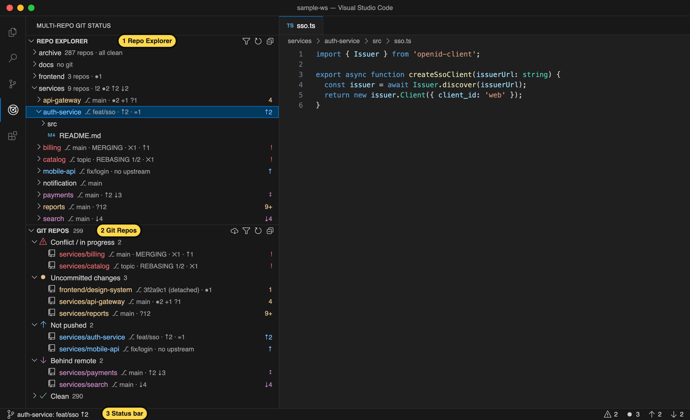
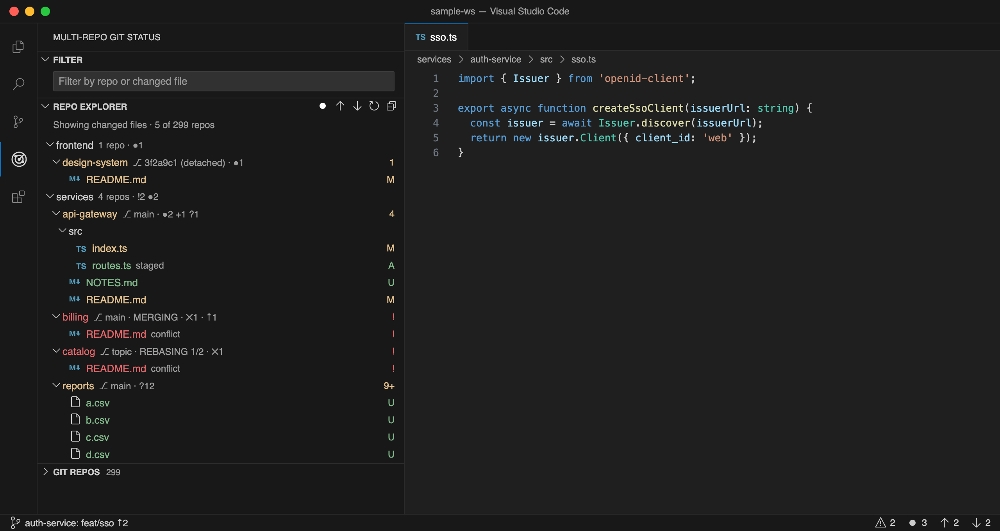
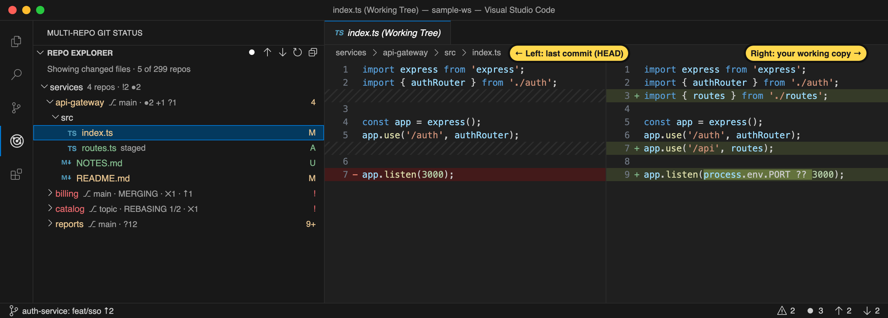
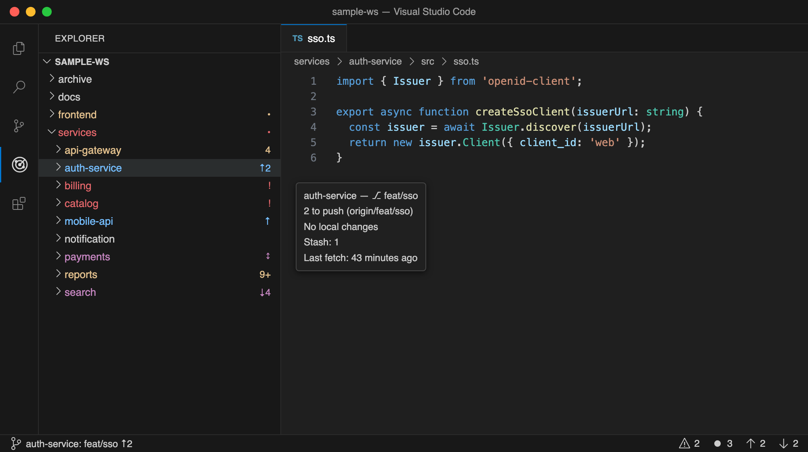
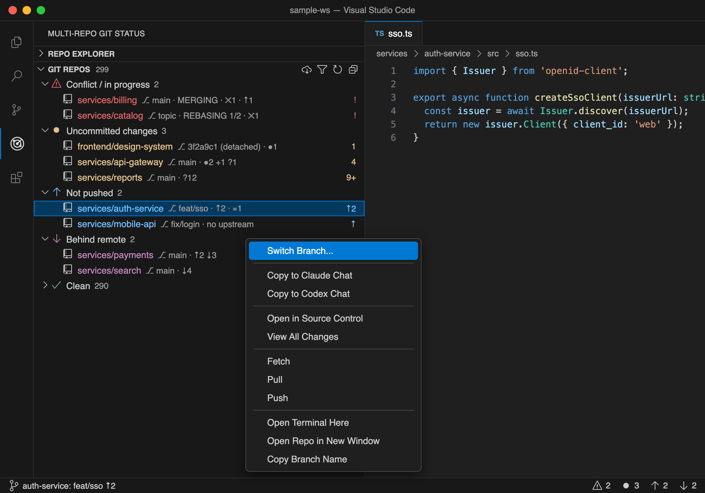
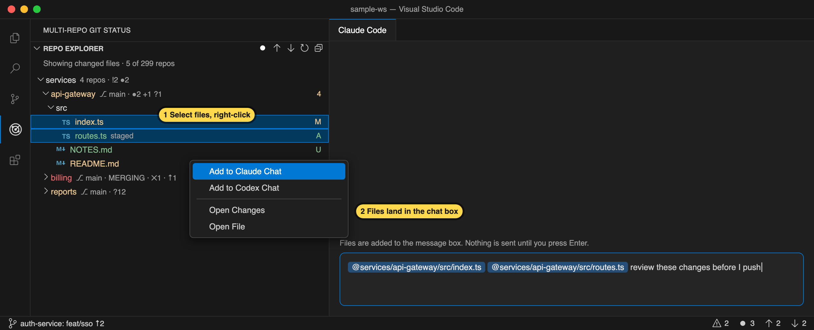

# Multi-Repo Git Status

**A VS Code extension that shows the branch and git status of every repository in your workspace — at a glance, even with hundreds of repos.**

If you keep many git repos in one folder (microservices, a polyrepo, a `~/projects` folder…), it's hard to remember which repo is on which branch, which ones have uncommitted work, and which ones you forgot to push. This extension puts all of that next to the folder names.



1. **Repo Explorer**: your files, with each repo's branch and status written after its name.
2. **Git Repos**: every repo, grouped by what needs your attention. Problems are listed first.
3. **Status bar**: the branch of the repo you're editing in (left) and totals for all repos (right).

## Features

### See every repo's branch and status

Open the **Multi-Repo Git Status** icon in the Activity Bar.

- **Repo Explorer** works like the normal Explorer: expand folders and click files to open them. Each repo shows its branch and status after its name. Folders that contain repos show a summary like `9 repos · !2 ●2 ↑2 ↓2`, so you can tell what's inside without expanding them.
- **Git Repos** lists every repo, grouped: *Conflict / in progress*, *Uncommitted changes*, *Not pushed*, *Behind remote*, *Clean*. Click the filter icon to find a repo by path or branch name.

### Show only what changed

The **Repo Explorer** title bar has three filter buttons. Click one to turn it on, and click it again to turn it off. The icon is filled while it's on. You can turn on more than one, and repos matching any of them are shown.

| Button | Off | On | Shows |
| --- | --- | --- | --- |
| Changed files | ○ | ● | Repos with uncommitted or conflicted files, listing only those files and the folders they're in |
| Not pushed | ↑ | ⬆︎ in a circle | Repos with commits that aren't pushed yet |
| Behind remote | ↓ | ⬇︎ in a circle | Repos with new commits on the remote (as of the last fetch) |



Changed files get the same letters as VS Code's Source Control: `M` modified, `A` added, `D` deleted, `R` renamed, `U` untracked, `!` conflict. The filter is remembered per workspace.

**Click a changed file to review it.** It opens a diff of the last commit (`HEAD`) against your working copy, so you see staged and unstaged changes together. New files show as fully added, and deleted files as fully removed. Files with conflicts open as normal files so you can resolve them. To open the file itself, use the **Open File** button on its row.



Added lines are green and removed lines are red. Within a changed line, the exact part that changed is highlighted. The diff opens as a preview tab, so clicking the next file replaces it instead of piling up tabs. To review every changed file of a repo in one tab, right-click the repo and choose **View All Changes**.

### Badges in the built-in Explorer (optional)

The built-in Explorer is left unchanged by default. Turn on `multiRepoGit.decorateExplorer` to also give repo folders there a color, a short badge, a tooltip, and a **Git Repo** right-click menu.



> VS Code lets extensions show only a color and a badge of up to two characters in the built-in Explorer. To see branch names next to folders, use **Repo Explorer**.

### Right-click a repo



| Command | What it does |
| --- | --- |
| Open in Source Control | Opens the repo in VS Code's Git and shows the Source Control view |
| View All Changes | Opens every changed file of the repo in one diff view |
| Switch Branch… | Lists local and remote branches and switches to the one you pick |
| Fetch / Pull / Push | Runs the git command for this repo. Push sets an upstream if the branch has none |
| Open Terminal Here | Opens a terminal in the repo folder |
| Open Repo in New Window | Opens just this repo in a new VS Code window |
| Copy Branch Name | Copies the current branch name |

With `multiRepoGit.decorateExplorer` on, the same commands are also in the built-in Explorer, under **Git Repo** when you right-click a repo folder.

The toolbar of the **Git Repos** view also has **Fetch All Repos**, **Filter Repos**, and **Refresh**.

### Send files to Claude Code or Codex

If you have [Claude Code](https://marketplace.visualstudio.com/items?itemName=anthropic.claude-code) or [Codex](https://marketplace.visualstudio.com/items?itemName=openai.chatgpt) installed, right-click in the Repo Explorer to hand files to its chat. Select several rows first (<kbd>Cmd</kbd>/<kbd>Ctrl</kbd>+click or <kbd>Shift</kbd>+click) to send them all at once. Combined with the **Changed files** button, this makes it quick to ask for a review of what you're about to push.



| Right-click on | Menu | What happens |
| --- | --- | --- |
| A file | **Add to Claude Chat** / **Add to Codex Chat** | The file is added to the chat's message box |
| A folder or repo | **Copy to Claude Chat** / **Copy to Codex Chat** | `@path/` is copied and the chat is opened. Paste it with <kbd>Cmd</kbd>/<kbd>Ctrl</kbd>+<kbd>V</kbd> |

Nothing is sent until you press <kbd>Enter</kbd> in the chat. Folders are copied rather than added because neither extension offers a way to add a folder for you. Each menu item only appears when that extension is installed.

> Claude Code can only mention the file open in the editor, so **Add to Claude Chat** briefly opens each file in a preview tab first. If a chat extension refuses a file, its `@path` is copied instead.

## What the symbols mean

| Badge | Color | Meaning |
| --- | --- | --- |
| *(none)* | normal | Clean and in sync with its upstream |
| `4`, `9+` | yellow | Files with uncommitted changes |
| `↑2` | blue | 2 commits not pushed yet |
| `↑` | blue | The branch has never been pushed (no upstream) |
| `↓4` | purple | 4 commits behind the remote, as of the last fetch |
| `↕` | purple | Diverged: commits to push *and* to pull |
| `!` | red | Files with merge conflicts |
| `M` `R` `C` `V` | red | Merge, rebase, cherry-pick or revert in progress |
| `D` | yellow | Detached HEAD (not on a branch) |
| `…` | gray | Still checking |
| `⚠` | red | The status could not be read. Hover for the error |

When a repo has several states at once, the badge shows the most important one. The text after the name shows all of them:

| Text | Meaning |
| --- | --- |
| `⎇ main` | Current branch |
| `●2` | 2 files modified |
| `+1` | 1 file staged |
| `?1` | 1 untracked file |
| `✕1` | 1 file with conflicts |
| `↑2 ↓3` | 2 commits to push, 3 to pull |
| `≡1` | 1 stash entry |
| `MERGING`, `REBASING 1/2` | An operation is in progress (rebase step 1 of 2) |

Other folders show `no git` (no repos inside), `not scanned` (deeper than the scan limit; right-click and choose **Scan This Folder**), or `excluded`.

## Install

The extension isn't on the VS Code Marketplace yet. Build it from source:

```bash
git clone https://github.com/prateep-r/vscode-multi-repo-git-status.git
cd vscode-multi-repo-git-status
npm install
npx @vscode/vsce package
code --install-extension multi-repo-git-status-0.0.1.vsix
```

Requirements: VS Code 1.95 or later, Node.js 20 or later, and `git` on your `PATH`.

To uninstall:

```bash
code --uninstall-extension local.multi-repo-git-status
```

## Settings

| Setting | Default | Description |
| --- | --- | --- |
| `multiRepoGit.scanDepth` | `3` | How many folder levels below each workspace folder to search for repos |
| `multiRepoGit.exclude` | `node_modules`, `vendor`, `dist`, `build`, `out`, `target`, … | Folder names that are never searched |
| `multiRepoGit.decorateExplorer` | `false` | Also show repo colors, badges, and the **Git Repo** menu in the built-in Explorer |
| `multiRepoGit.maxConcurrency` | `6` | Maximum number of git processes at the same time |
| `multiRepoGit.countUntracked` | `true` | Count untracked files. Turn off for faster checks in very large repos |
| `multiRepoGit.refreshOnFocus` | `true` | Re-check repos when the VS Code window gets focus |
| `multiRepoGit.backgroundRefreshMinutes` | `5` | Re-check all repos this often. `0` turns it off |

You can change the colors with `workbench.colorCustomizations`:

```jsonc
"workbench.colorCustomizations": {
  "multiRepoGit.aheadForeground": "#4FC1FF",
  "multiRepoGit.behindForeground": "#D18AE0"
}
```

Available colors: `multiRepoGit.conflictForeground`, `multiRepoGit.dirtyForeground`, `multiRepoGit.aheadForeground`, `multiRepoGit.behindForeground`, `multiRepoGit.pendingForeground`, `multiRepoGit.errorForeground`.

## Performance

Tested with 300 repos: they are found in about 50 ms, every repo shows its branch right away, and all statuses are checked in about 4 seconds in the background.

- **Branch and in-progress state** (merge, rebase…) are read directly from files in `.git`, without running git.
- **`git status`** runs through a queue, a few at a time. Repos you're working in go first, then repos on screen, then the rest.
- **Changes are picked up automatically**, including commits made in a terminal outside VS Code. The extension uses VS Code's own file watcher and debounces changes per repo.
- **Your own git commands aren't blocked.** Status checks never take git's `index.lock`.
- **Nothing is fetched automatically.** "Behind remote" is based on your last fetch. Use **Fetch All Repos** to update it.

## Known limitations

- **Open in Source Control** shows the Source Control view but can't select the repo for you. VS Code has no API for that. Use **Open Repo in New Window** to get a Source Control view with only that repo.
- A repo nested inside another repo is only found if it's a submodule, or if the outer repo is itself a workspace folder.
- Only local folders are supported (not Remote SSH, WSL, or virtual workspaces).

## Development

```bash
npm install
npm test                                     # unit tests
scripts/make-sample-repos.sh /tmp/sample-ws 300   # sample workspace with repos in every state
VSCODE_PATH="/Applications/Visual Studio Code.app/Contents/MacOS/Code" \
  npm run test:integration -- /tmp/sample-ws # tests inside a real VS Code
```

Press <kbd>F5</kbd> in VS Code to run the extension in a new window.

| Path | Contents |
| --- | --- |
| `src/core/` | Logic with no VS Code dependency: parsing `git status`, reading `.git`, the job queue, and the rules for which state and badge to show |
| `src/store.ts` | Keeps every repo's state up to date: discovery, refresh queue, file watching |
| `src/views/` | Repo Explorer, Git Repos view, Explorer decorations, status bar |
| `src/commands.ts` | Right-click and toolbar commands |

## License

[MIT](LICENSE)
